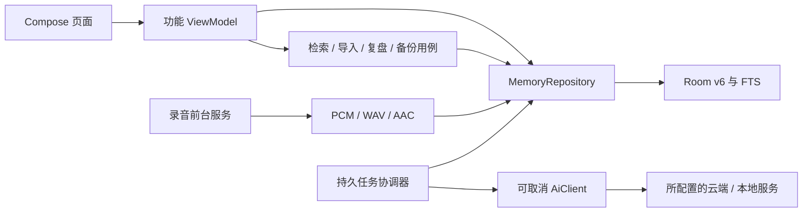

# 4.0 整体 review 与重构

基线：`80669f4`，原 D 盘 `feat/v3.0-rewrite`。原项目约 10,870 行 Kotlin；设置、播放器、时间线等页面直接承担数据库和网络任务，多个功能共用一行录音记录与 JSON 字段。

## 主要问题与处理

| 优先级 | 基线问题 | 4.0 处理与影响 |
|---|---|---|
| P0 | 默认配置含可用服务密钥，旧源码与历史记录可能泄漏凭据 | 默认密钥清空；旧默认凭据通过指纹识别并移除；用户另行配置的旧密钥迁移至 Keystore 加密存储。日志与备份排除凭据。已进入历史的密钥仍需在服务商处撤销。 |
| P0 | 录音停止与 PCM 写入竞争，编码器等待 EOS 无截止时间 | 单一采集者，非阻塞读取；停止、等待采集任务退出、封存文件按序执行；编码输入与 EOS 提交/排空均有截止时间，异常释放资源。 |
| P0 | 数据库升级允许破坏性回退，同名 v5 重构包与现有 v5 不兼容 | 显式迁移至 v6；升级前备份数据库/WAL；未知结构直接停止并保留数据，未覆盖 `_v32_refactor` 旧包。 |
| P1 | 模型整理稿可能覆盖转写文本，原话与润色稿无法区分 | 原稿、整理笔记、话题、待办、来源引用独立存储；原稿首次写入后不可覆盖。旧文本标记 LEGACY。 |
| P1 | 最新少量摘要代替跨记忆检索，长内容尾部被截断 | FTS4 加中文子串回退；问题关键词召回原稿，再选择带原始偏移的窗口；长原稿全部分块整理。检索仍受候选与上下文上限约束，未实现向量检索。 |
| P1 | 待办埋在会话 JSON 中，重新生成会重置完成状态 | 独立任务表及 CAS 状态迁移；候选、待办、完成、忽略四态；同原话的已确认或忽略事项不会重复加入候选。 |
| P1 | 上传中断后遗留 UPLOADING，无持久处理阶段 | ASR、MAP、DERIVE、IMPORT、DIGEST 持久任务；原子认领、重试、等待配置/网络/依赖状态；进程恢复修复 WAV 与 ADTS 尾部。 |
| P1 | AAC 格式误标，网络调用不可取消 | 共享可取消 OkHttp；Step Plan 嵌套 SSE 与通用 multipart 显式分离；ADTS AAC 先解码为 WAV，限制上传与响应大小。 |
| P1 | 今日复盘一次性读取，生成期间来源可能变化 | 当前日期独立状态；生成时捕获已就绪原稿 ID 与指纹，保存可核对引用；有新来源时提示更新。 |
| P1 | 后端 `.removePrefix()` 在 Python 中无效，SSE 连接未释放 | 重写网关，完整解析 done/delta/error；成功、异常、断连均关闭响应；失败保留原始转写并区分整理状态。 |
| P2 | 四个底栏入口与居中录音键挤占阅读区，大型设置滚动页负担重 | 三个平级底栏；设置移至右上角并按服务、录音、外观、数据拆页；录音键移至右下角。 |
| P2 | 多套装饰、字体与位图角色不易适配主题，状态表述不准确 | 单一蓝色强调与中性灰；移除旧位图和字体，矢量侧耳八种姿态；区分无记忆、筛选为空、无匹配、无引用、原音缺失。 |

## 代码边界

导航只传会话、话题、音频 ID 和字符范围。页面不直接发网络请求，列表不读取全部原稿。回听资源随导航离开释放。原稿引用是 UTF-16 字符范围，并再次按原文校验；当前 ASR 未提供逐字音频时间，因此不估算逐字回听位置。

## UI 与交互取舍

记忆列表以话题和会议为阅读单位；搜索与提问独立，回答后先展示可点开的引用。详情把概览与原稿分开，播放器固定底部。录音的收起保留应用内小条，不模拟上传百分比。侧耳用圆形对话泡与短尾、胶囊眼睛表达状态，深色主题反相。

重新整理、手动清理原音、隐藏话题与删除整次记录分别处理。隐藏卡片不删除原稿；清理原音不删除文字；删除记录不撤销用户已确认的待办。

此版本面向个人使用，未加入多人权限、云同步或远程账户管理。模型内容仍可能不准确，产品提供原稿与原音核对路径；实际服务连接、设备编解码器与长时间后台录音需真机验收。
